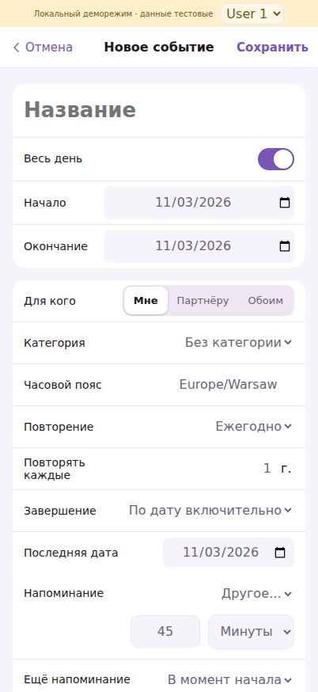
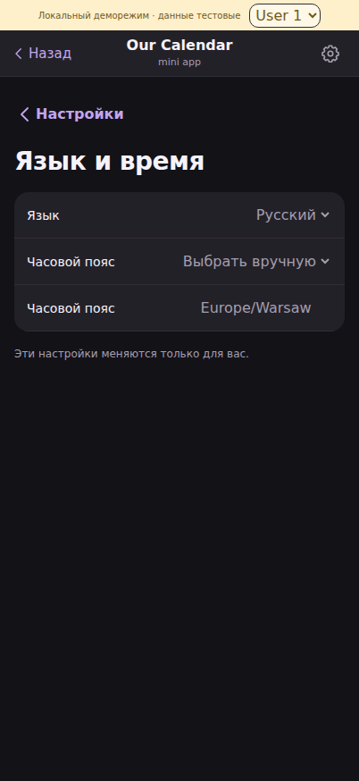

# #38 / #40 — протокол подготовки 0.10.7

Дата: 30 октября 2026. База: `main` / `22e3c09e431fba158c02368ba4c7723a2730f39a`.
Отдельная ветка: `fix/all-day-inclusive-touch-inputs`. Прочитаны AGENTS.md,
IMPLEMENTATION.md, исходное ТЗ, #38, #40 и открытый #54. На этой базе оба
дефекта сохранялись; исправляющих PR кроме независимого месячного #54 не было.

## Поведение

- «Весь день»: дата окончания в форме — последний включённый день. 3–5 ноября
  показывается в карточке и календаре 3, 4, 5 ноября. API/SQLite/ICS по-прежнему
  хранят окончание 6 ноября. Пересчёт выполняется только на границах формы.
- Однодневные события показывают одну дату; диапазоны через Новый год содержат
  оба года. При начале позже окончания форма показывает однодневное событие.
- Повторное открытие/сохранение и перерисовки редактора повторений не сдвигают
  окончание. Переключатель «Весь день» обрабатывает ещё не перерисованные timed
  поля без попытки прибавить день к datetime. Прежняя политика временных defaults
  при выключении переключателя сохранена.
- Для coarse pointer, в том числе hybrid-устройств, input/select/textarea имеют
  16 CSS px. Крупное название события сохраняет 26/24 px. Desktop mouse controls
  сохраняют прежний размер. Viewport не ограничивает пользовательский zoom.
- Изменений схемы, импорта/экспорта, прав, провайдеров и production-данных нет.
  Python production diff содержит только номер версии.

## Автоматические проверки

Playwright **1.56.0 / Chromium 141, Linux**, мобильная эмуляция hasTouch/isMobile.
Только синтетические аккаунты и временные SQLite; Telegram SDK заблокирован.
Все проверки ниже прошли; ни один результат не означает проверку реального iPhone.

| Проверка | Результат |
| --- | --- |
| `python -m pytest -q` | 387 passed; предупреждение Starlette об httpx/httpx2 |
| `node --test tests/*.test.cjs` | 35 passed |
| `python -m compileall -q app scripts`, JS syntax | Passed |
| Все 9 прежних браузерных сценариев из CI | Passed; week и Google используют одинаковый порт, запускать последовательно |
| `browser-event-allday-range.cjs` | Create/edit/reopen/save/rerender, one/multiple days, month/year/leap-day boundaries, API/ICS exclusive end, реальные недельные ячейки, start clamp, timed/toggles, RU/EN и Warsaw/Melbourne |
| `browser-form-font-size.cjs` | Полное произведение RU/EN × light/dark × 320/390/402/430 px; computed font ≥16, title >16, нет горизонтального переполнения/выхода полей; desktop font 14 px и разрешённый pinch zoom |
| Экраны проверки полей | Event timed/all-day, translations/DST, weekly/monthly/yearly recurrence и COUNT/UNTIL, custom reminders; все 9 разделов настроек, custom duration; category/HEX/translations, default/event reminders, occurrence month, Smart Events title dialogs |

Новые сценарии добавлены в `.github/workflows/test.yml`. Они запускают сервер
на свободном порту, выключают внешние ключи и очищают временную БД. Чтобы не
отключать настоящий rate limiter, большие матрицы разбиты на изолированные
серверы. Для повторения: `pip install -r requirements-dev.txt`,
`npm install --no-save playwright@1.56.0`, `npx playwright install --with-deps chromium`,
затем команды из CI. `CALENDAR_SCREENSHOT_DIR=...` сохраняет снимки font-сценария.

### Подтверждение регрессии и старые тестовые даты

До исправлений оба новых сценария падали: новая форма all-day показывала
4 ноября вместо 3 ноября; при 320 px поля имели 10/12/13/14 px.

До изменений на main полный Python suite давал **23 failed / 364 passed**:
события provider-фикстур 24 октября уже прошли, поэтому auto-import правильно их
не импортировал. Та же причина ломала прежний Google browser acceptance.
Исправлена только воспроизводимость тестовых часов: `ProviderFixtureDateTime`
в provider-фикстурах и синтетическом Google browser server задаёт 20 октября.
TTL, lease и stamp используют согласованное время. Production-код eligibility
не ослаблен и не изменён. После этого все 387 тестов и Google browser прошли.

## Независимость от PR #54

Проверенный head #54: `237208160c4fdb807831b3e5528f2a9754e4f021`.
Месячный PR не слит, его файлы/снимки/изменения не перенесены в эту ветку.
В отдельном временном worktree проверяется объединение двух веток.

- `web/app.js`, `web/style.css` и CI объединяются автоматически: изменения формы
  не затрагивают `monthCell`/`scrollingWeek`/resize/геометрию месяца. Новые CI-шаги
  вставлены перед прежними browser-шагами, чтобы не конфликтовать с добавленным
  в #54 месячным сценарием.
- Конфликты **только версии**: `app/main.py`, `app/health.py`, `pyproject.toml`,
  `web/index.html` — 0.10.7 против 0.11.0. В совместном дереве сохранена 0.11.0;
  после будущего объединения сохранить её согласованно в этих четырёх файлах.
- В совместном дереве: новые сценарии дат/полей, `browser-calendar-month-scroll.cjs`
  из #54 и его версия `browser-calendar-design.cjs`. Это локальная проверка
  совместимости; production и ветка #54 не изменялись.

## Визуальная проверка эмуляции

| Форма, светлая тема, 402 CSS px | Настройки, тёмная тема, 402 CSS px |
| --- | --- |
|  |  |

Дополнительные снимки: [тёмная форма](all-day-dark-402.png),
[светлые настройки](language-light-402.png). Цвета, поверхности и геометрия
прежние; изменён размер текста полей. Формат нативного date picker в Chromium
зависит от его окружения и не моделирует системный picker iOS.

## Приёмка на iPhone после разрешённой публикации

1. В Telegram полностью закрыть Mini App и открыть заново; проверить версию.
2. Создать «Поездка»: «Весь день», начало **3 ноября**, окончание **5 ноября**.
   В карточке 3–5 ноября; на неделе событие есть 3/4/5 и отсутствует 6 ноября.
3. Открыть редактирование: окончание 5 ноября. Сохранить два раза без изменения
   дат. Проверить однодневное событие и диапазон 31 декабря — 2 января.
4. В форме по очереди нажать дату/время, место, описание, категорию, повторение
   и собственное напоминание. В настройках — язык, ручной часовой пояс, имя,
   дату отношений и длительность. В категории — имя и HEX. Клавиатура/пикеры
   открываются без автоматического увеличения всей страницы; после закрытия
   клавиатуры масштаб прежний, ручной pinch zoom доступен.
5. Повторить ключевые поля в RU/EN и светлой/тёмной теме. Проверить поворот/
   изменение высоты Telegram и обычное событие со временем.

**Статус настоящего Telegram iOS: не проверено.** Вычисляемые 16 px и отсутствие
переполнения в Chromium подтверждены; отсутствие focus zoom/поведение клавиатуры,
safe-area и нативных picker на реальном iPhone подтверждает отдельная приёмка.
Слияние, deploy, живые провайдеры и сообщения пользователям в этой работе не выполнялись.
