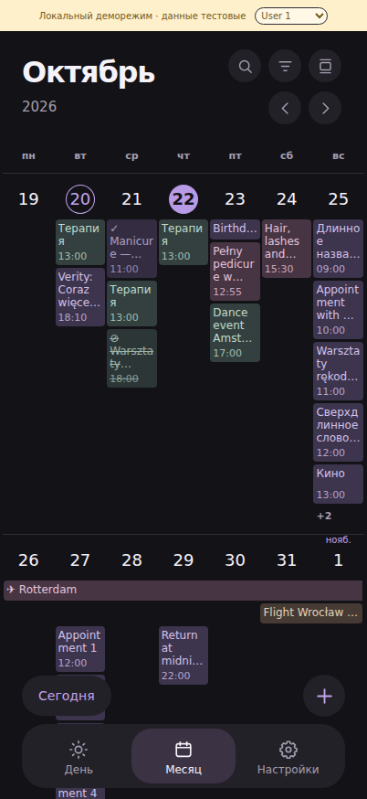
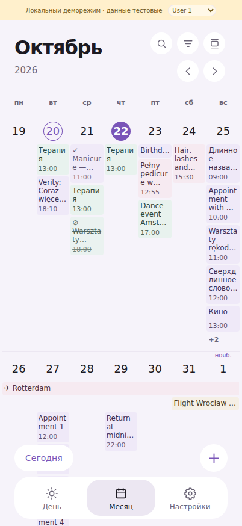

# Прокручиваемый месяц — проверка геометрии

База: `main`, `22e3c09e431fba158c02368ba4c7723a2730f39a`.
Изменения подготовлены отдельной веткой; слияние и production deployment не выполнялись.

Месяц использует семь равных колонок, внешние отступы 3 CSS px (с учётом safe-area)
и 2 px между карточками соседних дней. Верхняя панель, Touch Bar, Today, + и другие
виды календаря сохраняются. Обычный месяц по-прежнему показывает точки и список дня.

Временные карточки имеют заголовок 12 px / 14 px, до трёх строк с переносом по словам
и резервным разрывом слишком длинного слова; время — отдельную нижнюю строку 11 px.
Высота карточки зависит от текста, минимальная — 43 px. События без времени и
многодневные полосы компактные. Палитра категорий сохраняется; текст в светлой теме
затемнён локально для читаемости. Выполненные карточки отмечены галочкой и приглушены,
отменённые — символом и зачёркиванием. Остальные виды используют прежние цвета.

Весь день и timed-события, затрагивающие несколько местных дат, показываются одной
полосой на неделю. На границе недели рисуется продолжение, на границе месяца внутри
недели полоса не разрывается. Окончание в полночь исключает следующую дату.
Экземпляры повторений сохраняют отдельные ключи открытия. Полосы учитываются
в лимите пяти событий на дату; +N открывает полный список дня прежним действием.
При скрытом из-за лимита дне полоса разбивается на видимые участки.

Удалены height container queries, включая пороги 340/460/500 px, и прежние правила
растягивания отдельных дневных карточек через границу колонки. Изменение высоты
WebView меняет только минимальное пространство недели: max(260 px, половина
высоты scrollport). Загруженная неделя растёт по содержимому. Пустые недели занимают
примерно половину окна; при пяти длинных карточках видно меньше двух полных недель.
Шрифты, переносы и видимость времени от высоты окна не зависят.

ResizeObserver игнорирует начальное уведомление и повторную прежнюю высоту;
пересчёт сохраняет видимую неделю и смещение. Обновление данных сохраняет якорь;
если неделя стала короче прежнего смещения, оно ограничивается её новой высотой.

## Автоматическая проверка

- `python -m pytest -q`: 387 passed; одно предупреждение совместимости Starlette/httpx.
- `python -m compileall -q app scripts` и `node --check web/app.js`: успешно.
- `node --test tests/*.test.cjs`: 35 passed.
- Девять существующих браузерных сценариев из `.github/workflows/test.yml`: успешно.
- Новый `node tests/browser-calendar-month-scroll.cjs`: успешно; добавлен в CI.

Новый сценарий использует временную БД, синтетические аккаунты и события; проверяет
0/1/3/5/7 событий, RU/EN/PL и неразрывные названия, обе темы, выполненные/отменённые,
повторы, полосы на стыке недель/месяцев, midnight end, +N, открытие нужного
экземпляра, фильтр, подгрузку, уникальность дат, обновление и уменьшение недели.
Ширины 393/402 CSS px и высоты 500/620/760/874 px проверяют постоянство типографики,
высоты карточки при изменении высоты WebView, равенство колонок, отсутствие
перекрытия недель и сохранение якоря. Существующие сценарии дополнительно покрывают
320/390/430 px, жесты и другие виды приложения. В прежнем design-сценарии проверка
точной половины высоты заменена проверкой минимальной высоты; в коротком окне
проверяется возможность прокрутить сам +N выше плавающих кнопок.

## Скриншоты

Это **эмуляция мобильного viewport в Chromium 141 / Playwright 1.56 на Linux**,
не проверка на iPhone и не Telegram iOS WebKit. Размеры — тестовые CSS viewport;
они не объявляются физическими характеристиками iPhone 17 Pro / 18 Pro.
Шапка Telegram скрыта тестовым SDK, жёлтая строка — локальный деморежим.
Использованы только вымышленные данные. На настоящих устройствах остаётся проверить
фактическую доступную ширину, системный шрифт, safe-area, изменение панели Telegram
и плавность нативной прокрутки.

| CSS viewport | Тёмная тема | Светлая тема |
| --- | --- | --- |
| 393 × 874 | [Скриншот](month-chromium-dark-393.png) | [Скриншот](month-chromium-light-393.png) |
| 402 × 874 | [Скриншот](month-chromium-dark-402.png) | [Скриншот](month-chromium-light-402.png) |

